<div align="center">

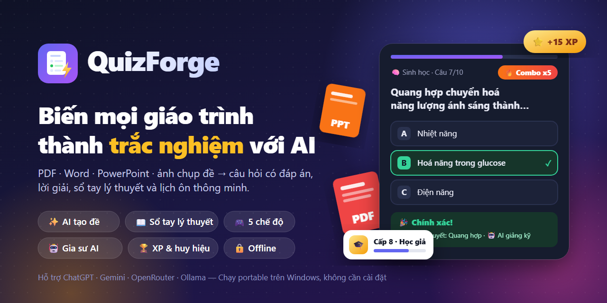

# QuizForge

### Biến mọi giáo trình thành trắc nghiệm với AI ⚡

Tải lên PDF, Word, PowerPoint hay ảnh chụp đề. AI lập **lộ trình học**, soạn **lý thuyết**, ra **bài tập tư duy** và câu hỏi có lời giải.<br>
Học để **hiểu** chứ không học vẹt — luyện như chơi game, nhớ lâu nhờ lịch ôn thông minh. Dùng được cho **mọi môn**.

[](https://github.com/TienQuangPP/QuizForge/releases/latest)
[](https://github.com/TienQuangPP/QuizForge/releases/latest)
[](#-kết-nối-ai)
[](#-kết-nối-ai)
[](#-không-có-api-key-dùng-ai-bên-ngoài)
[](#-quyền-riêng-tư)

**[⬇️ Tải bản mới nhất](https://github.com/TienQuangPP/QuizForge/releases/latest)** &nbsp;·&nbsp;
[✨ Tính năng](#-tính-năng) &nbsp;·&nbsp;
[📸 Ảnh chụp](#-ảnh-chụp-màn-hình) &nbsp;·&nbsp;
[🚀 Bắt đầu](#-bắt-đầu-trong-1-phút) &nbsp;·&nbsp;
[❓ Hỏi đáp](#-hỏi-đáp-nhanh)

</div>

---

## 🆕 Mới ở v1.4: học để hiểu, không học vẹt

<table>
<tr>
<td width="50%">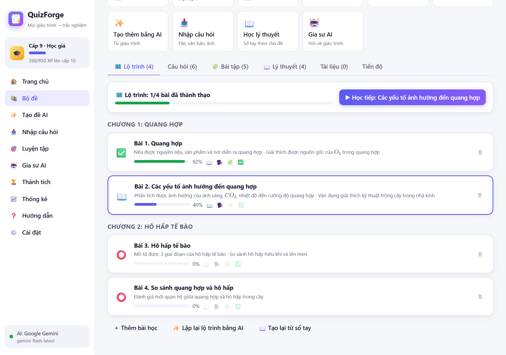<p align="center"><b>🗺️ Lộ trình học</b>: chương → bài, mục tiêu theo thang Bloom</p></td>
<td width="50%">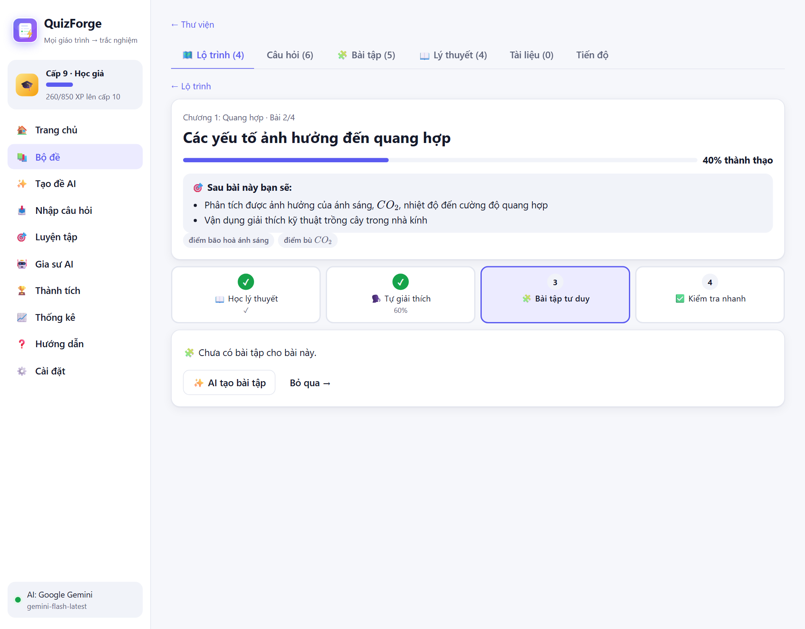<p align="center"><b>Mỗi bài 4 bước</b>: Học → Tự giải thích → Bài tập tư duy → Kiểm tra</p></td>
</tr>
<tr>
<td width="50%">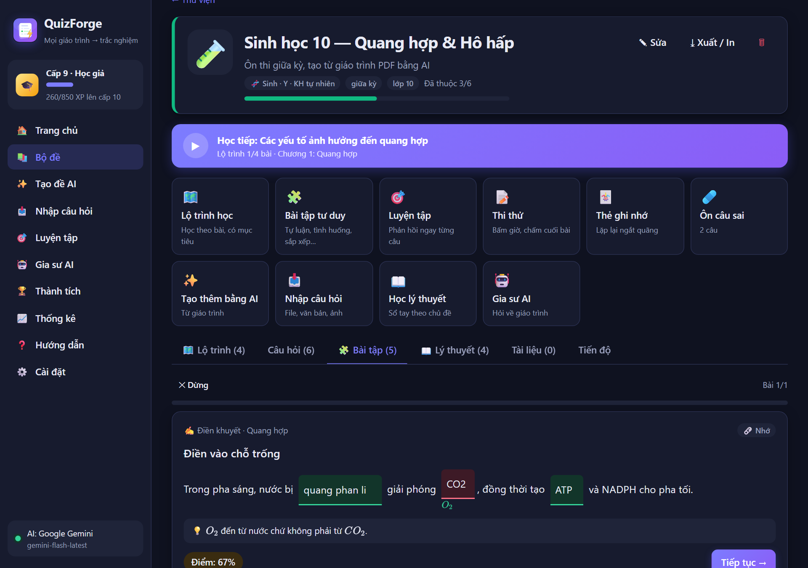<p align="center"><b>🧩 Bài tập tư duy</b>: chấm chặt, gõ "CO2" thay cho O₂ là sai</p></td>
<td width="50%">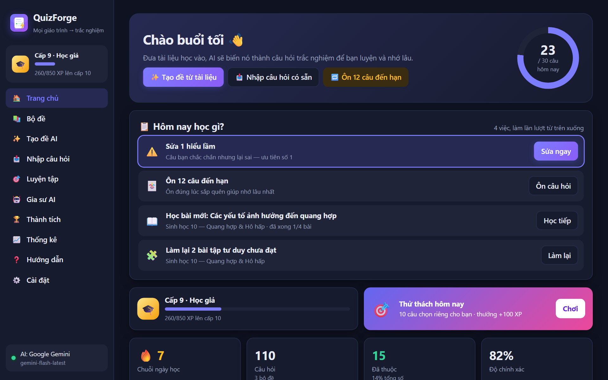<p align="center"><b>📋 Hôm nay học gì?</b>: một danh sách việc, mỗi việc một nút</p></td>
</tr>
</table>

- **🗺️ Lộ trình học**: AI chia giáo trình thành chương → bài theo thứ tự tiên quyết. Mỗi bài có mục tiêu đo được (Nêu được, Giải thích được, Vận dụng, Phân tích…) và điểm thành thạo. Bài đã thành thạo được nhắc **ôn lại sau 1 – 3 – 7 – 16 – 35 ngày**. Không có AI thì tạo lộ trình từ sổ tay lý thuyết.
- **🗣️ Tự giải thích (kỹ thuật Feynman)**: viết lại bài học bằng lời của bạn. AI chấm theo ý chính, chỉ ra **ý còn thiếu** và **chỗ hiểu sai**. Khi thử với Gemini thật, AI bắt được cả 2 lỗi hiểu sai cài sẵn ("O₂ sinh ra từ CO₂", "pha tối diễn ra ban đêm").
- **🧩 Bài tập tư duy** 6 dạng: ✍️ điền khuyết · 🔢 sắp xếp quy trình · 🔗 nối khái niệm · ⚖️ đúng/sai **kèm lý do** · 🧠 tự luận/tình huống · 🕵️ tìm lỗi sai. Trải từ Nhớ → Đánh giá. Không có AI vẫn tự chấm theo thang tiêu chí.
- **🎯 Mức độ tự tin**: trả lời kèm "😎 Chắc chắn / 🤔 Phân vân / 🎲 Đoán". **Chắc mà sai** là *hiểu lầm nguy hiểm*, được ưu tiên sửa trước; **đoán trúng** thì không được tính là đã thuộc.
- **📚 Mọi môn học**: chọn loại môn (Toán·Lý·Hoá, Sinh·Y, Xã hội·Luật·Kinh tế, Ngoại ngữ, Lập trình, Chuyên ngành) để AI ra đề đúng kiểu. **Công thức** hiển thị đẹp: $x^2$, $\frac{a}{b}$, $H_2SO_4$.
- **📋 Hôm nay học gì?** trên trang chủ cho người không rành công nghệ.
- **🤖 AI bền bỉ hơn**: tự chuyển model khi Google ngừng model cũ, tự thử lại khi quá tải, khi hết lượt miễn phí của một model thì tự dùng model khác. Chế độ "Nhanh" giúp AI trả lời nhanh gấp đôi.

---

## 💡 Vì sao là QuizForge?

<table>
<tr>
<td width="33%" valign="top">

### 📄 → 🤖 → ✅
**Có tài liệu là có đề.** Kéo thả giáo trình, chọn số câu và độ khó. Vài giây sau đã có bộ trắc nghiệm kèm lời giải, sẵn sàng để luyện.

</td>
<td width="33%" valign="top">

### 🧠 Hiểu chứ không học vẹt
**Sổ tay lý thuyết** theo từng chủ đề: ý chính, ví dụ, bảng so sánh, lỗi hay nhầm. Làm sai câu nào thì mở đúng phần lý thuyết của câu đó.

</td>
<td width="33%" valign="top">

### 🎮 Học như chơi game
**XP, cấp độ, 23 huy hiệu**, combo 🔥, đua tốc độ ⚡, sinh tồn ❤️ và thử thách mỗi ngày. Khó mà bỏ học giữa chừng.

</td>
</tr>
</table>

---

## 🌐 Không có API key? Dùng AI bên ngoài

Bạn đang dùng **ChatGPT, Gemini, Claude hay Copilot** bản web (miễn phí hoặc gói Plus)? QuizForge soạn sẵn câu lệnh, bạn chỉ việc **copy → gửi cho AI → dán kết quả về**:

<table>
<tr>
<td width="45%" valign="top">

1. **Chọn yêu cầu:** số câu, độ khó, ngôn ngữ, dạng câu, hoặc **sổ tay lý thuyết**.
2. **📋 Sao chép câu lệnh** → bấm **Mở ChatGPT / Gemini / Claude** → đính kèm giáo trình → gửi.
3. **Dán câu trả lời** về QuizForge → xem lại → lưu.

✅ Nhận được JSON, Markdown in đậm, gạch đầu dòng, bảng đáp án dồn cuối (`1-B, 2-C`), `✅ Answer: …`<br>
⚠️ Câu thiếu đáp án hoặc nghi sai được **tô đỏ** và hỏi lại trước khi lưu<br>
🔁 AI dừng giữa chừng? Gõ "tiếp tục" rồi dán thêm, câu trùng tự loại

</td>
<td width="55%">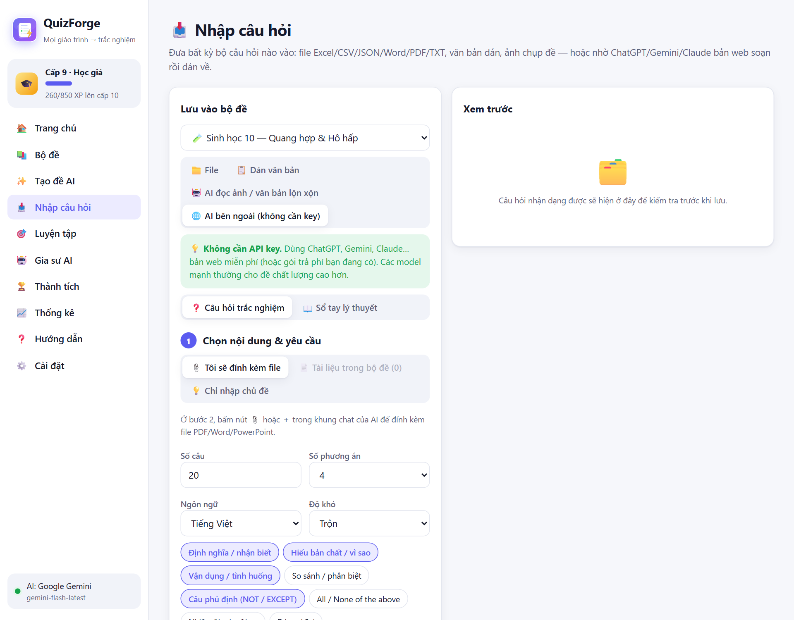</td>
</tr>
</table>

---

## 📸 Ảnh chụp màn hình

<table>
<tr>
<td width="50%"><p align="center"><b>Trang chủ</b>: mục tiêu ngày, cấp độ, thử thách hôm nay</p></td>
<td width="50%">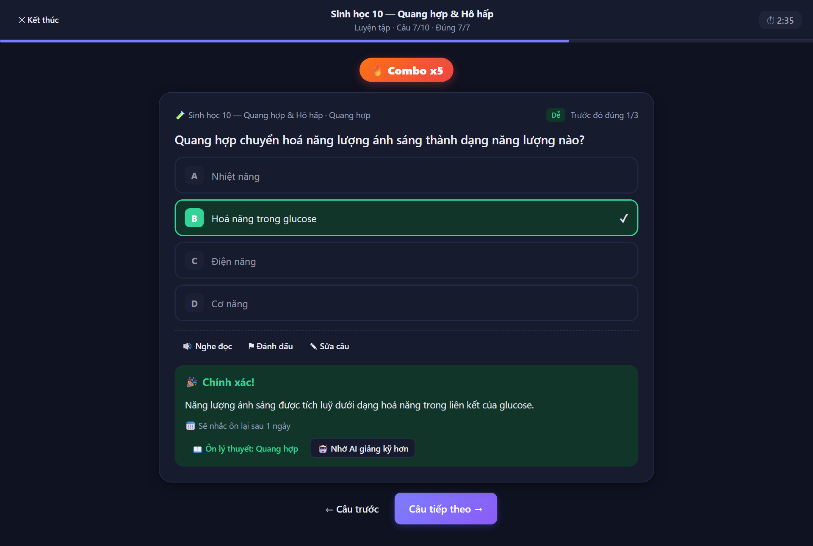<p align="center"><b>Làm bài</b>: combo, giải thích, ôn lý thuyết ngay tại chỗ</p></td>
</tr>
<tr>
<td width="50%">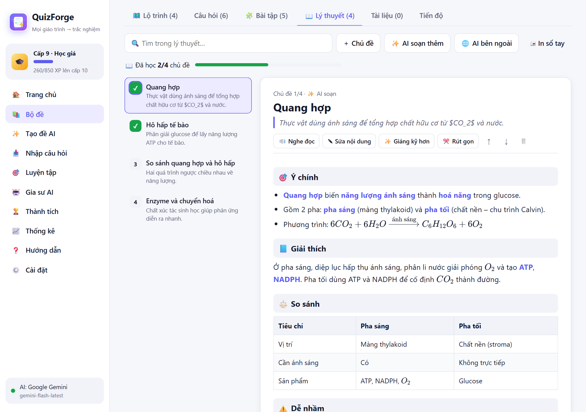<p align="center"><b>Sổ tay lý thuyết</b>: AI soạn theo chủ đề, có bảng so sánh</p></td>
<td width="50%">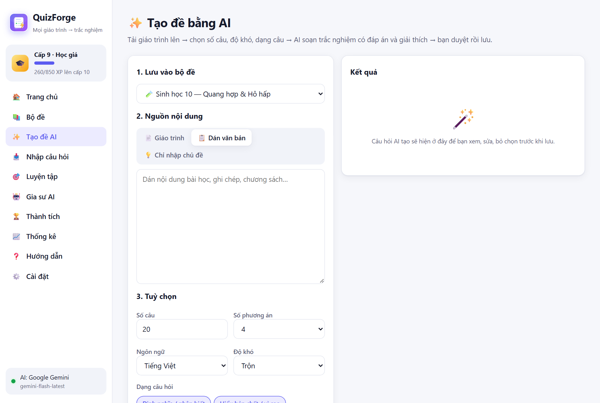<p align="center"><b>Tạo đề bằng AI</b>: chọn số câu, độ khó, 9 dạng câu hỏi</p></td>
</tr>
<tr>
<td width="50%">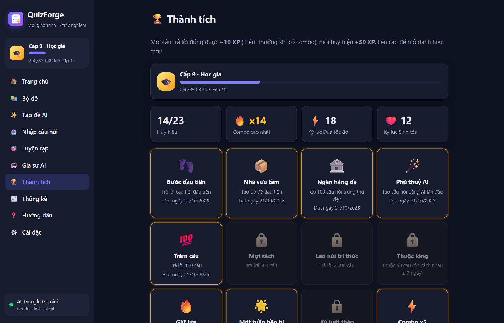<p align="center"><b>Thành tích</b>: huy hiệu, kỷ lục, danh hiệu</p></td>
<td width="50%">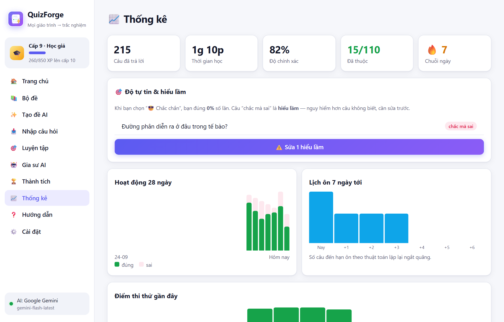<p align="center"><b>Thống kê</b>: hoạt động, lịch ôn, điểm thi thử</p></td>
</tr>
</table>

<p align="center">
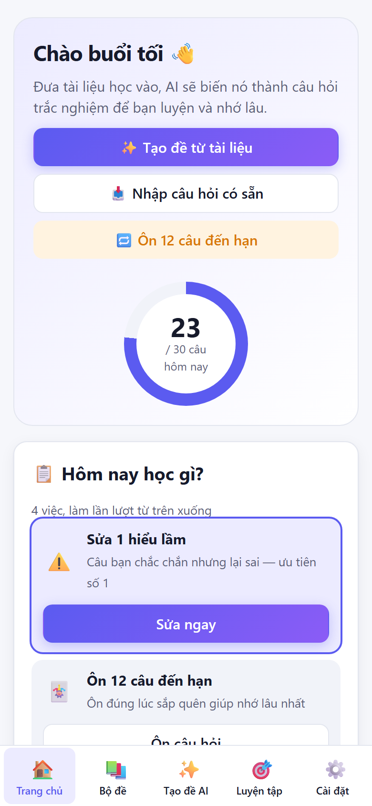
&nbsp;&nbsp;&nbsp;
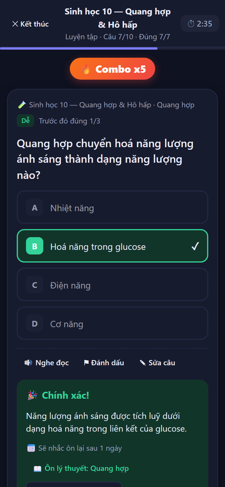
<br><i>📱 Dùng tốt trên điện thoại</i>
</p>

---

## ✨ Tính năng

<details open>
<summary><b>🤖 AI biến tài liệu thành đề</b></summary>

- **Đọc mọi định dạng:** PDF, Word (.docx), PowerPoint (.pptx, đọc cả ghi chú slide), TXT, Markdown, HTML.
- **Tuỳ chỉnh đề:** số câu (1–300), 3–6 phương án, tiếng Việt / English / song ngữ, độ khó trộn hoặc cố định.
- **9 dạng câu hỏi:** định nghĩa, hiểu bản chất, vận dụng tình huống, so sánh, NOT/EXCEPT, All/None of the above, nhiều đáp án đúng, Đúng/Sai, số liệu.
- **Không cần tài liệu:** nhập một chủ đề như *"Chiến tranh thế giới thứ 2"*, AI tự soạn rồi ra đề.
- **Duyệt trước khi lưu:** xem, sửa, bỏ chọn từng câu. Câu trùng được tự loại bỏ.
- **Không cần API key:** dùng ChatGPT/Gemini/Claude bản web qua câu lệnh soạn sẵn ([xem trên](#-không-có-api-key-dùng-ai-bên-ngoài)).
- **Đọc ảnh chụp đề:** chụp màn hình rồi Ctrl+V. AI nhận câu hỏi và tự giải nếu đề chưa có đáp án.

</details>

<details open>
<summary><b>📖 Sổ tay lý thuyết</b></summary>

- **Soạn theo chủ đề:** AI soạn sổ tay gồm 🎯 ý chính, 📘 giải thích, 🧩 ví dụ, ⚖️ bảng so sánh, ⚠️ lỗi hay nhầm, 💡 mẹo nhớ.
- **Học theo cách của bạn:** 🔊 nghe đọc, ✎ sửa tay, ✨ giảng kỹ hơn, ✂️ rút gọn, 🖨 in cả sổ tay.
- **Theo dõi tiến độ:** đánh dấu "đã hiểu" từng chủ đề, rồi **luyện ngay các câu cùng chủ đề**.
- **Nối với bài làm:** làm sai thì có nút **"📖 Ôn lý thuyết"** mở đúng phần liên quan mà không phải rời bài.

</details>

<details open>
<summary><b>🎯 5 chế độ luyện tập</b></summary>

| Chế độ | Dành cho |
|---|---|
| 🎯 **Luyện tập** | Biết đúng/sai ngay, có giải thích và lý thuyết |
| 📝 **Thi thử** | Bấm giờ (hoặc không giới hạn), chấm điểm thang 10 |
| 🃏 **Thẻ ghi nhớ** | Tự chấm Quên / Khó / Nhớ / Dễ theo thuật toán lặp lại ngắt quãng |
| ⚡ **Đua tốc độ** | Đúng càng nhiều càng tốt trong 60/90/120 giây |
| ❤️ **Sinh tồn** | 3 mạng, sai 3 lần là thua, có lưu kỷ lục |

Thêm **🧠 chế độ chọn câu thông minh** (ưu tiên câu yếu), **🎯 thử thách hằng ngày** và **🩹 ôn riêng câu sai**.

</details>

<details>
<summary><b>🎮 Game hoá</b></summary>

- **XP và 7 danh hiệu:** Tập sự → Chăm chỉ → Ham học → Học giả → Chuyên gia → Bậc thầy → Huyền thoại 👑.
- **23 huy hiệu:** combo x25, chuỗi 30 ngày, điểm tuyệt đối, cú đêm 🦉, nhà lý luận 📖…
- **Hiệu ứng:** combo 🔥, pháo giấy 🎉, âm thanh đúng/sai (tắt được).

</details>

<details>
<summary><b>📥 Nhập câu hỏi có sẵn</b></summary>

| Nguồn | Cách nhập |
|---|---|
| Excel / CSV | Cột `question, A, B, C, D, answer, explanation, topic` |
| Word / PDF / TXT | Dạng `Câu 1: … A. … B. … Đáp án: B` hoặc đánh dấu `*` trước đáp án đúng |
| JSON | File xuất từ QuizForge, mảng `{question, options, answer}` |
| Kết quả copy từ ChatGPT / Gemini / Claude | Dán thẳng, tự bỏ định dạng Markdown, hiểu bảng đáp án dồn cuối |
| Ảnh / văn bản lộn xộn | Để AI đọc và chuẩn hoá |

</details>

<details>
<summary><b>👵 Dễ dùng cho mọi lứa tuổi</b></summary>

- **Màn hình chào mừng:** chọn **cỡ chữ** (4 mức, đến "Cực lớn") và màu nền ngay từ đầu.
- **Đọc to:** 🔊 đọc câu hỏi và lời giải, có thể bật tự đọc từng câu.
- **Lấy API key dễ dàng:** hướng dẫn 5 bước bằng lời thường, dán key xong app tự kiểm tra.
- **Trang ❓ Hướng dẫn:** 12 câu hỏi thường gặp.
- **Phím tắt:** `1–4` chọn · `Enter` tiếp · `R` đọc to · `F` đánh dấu.

</details>

<details>
<summary><b>🛡️ Không lo mất dữ liệu</b></summary>

- **Tự lưu bài đang làm:** tải lại trang vẫn có nút **"Làm tiếp"**.
- **Hoàn tác:** nút ↶ khi lỡ xoá câu hỏi, bộ đề, tài liệu hay chủ đề lý thuyết.
- **Sửa nhanh:** sửa câu hỏi ngay trong lúc làm bài.
- **Sao lưu:** sao lưu / khôi phục bằng 1 file, có nhắc khi lâu chưa sao lưu.

</details>

---

## 🚀 Bắt đầu trong 1 phút

1. **Tải** `QuizForge_Portable.zip` ở mục [Releases](https://github.com/TienQuangPP/QuizForge/releases/latest).
2. **Giải nén** toàn bộ vào một thư mục bất kỳ.
3. **Nhấp đúp** `START_QuizForge.bat`. Trình duyệt tự mở `http://127.0.0.1:3105`.

> Không cần cài đặt (đã kèm sẵn Node runtime). Tắt app bằng `STOP_QuizForge.bat` hoặc đóng cửa sổ đen.

## 🔑 Kết nối AI

| Nhà cung cấp | Chi phí | Lấy key |
|---|---|---|
| **Google Gemini** ⭐ khuyên dùng | Miễn phí (giới hạn số lần mỗi ngày cho từng model; app tự đổi model khi hết lượt) | [aistudio.google.com/apikey](https://aistudio.google.com/apikey) |
| **OpenAI (ChatGPT)** | Trả theo lượng dùng (20 câu ≈ dưới 1.000đ) | [platform.openai.com/api-keys](https://platform.openai.com/api-keys) |
| **OpenRouter · Groq · DeepSeek** | Tuỳ nhà cung cấp | Chuẩn API OpenAI |
| **Ollama · LM Studio** | Miễn phí, chạy trên máy bạn | Không cần key |

Vào **⚙️ Cài đặt → Kết nối AI**, dán key. App tự kiểm tra kết nối ngay.

## 🔒 Quyền riêng tư

- **Dữ liệu ở trên máy bạn:** bộ đề, tài liệu và tiến độ nằm trong trình duyệt trên chính máy của bạn, không có máy chủ trung gian.
- **AI chỉ chạy khi bạn bấm:** nội dung chỉ được gửi tới nhà cung cấp AI bạn chọn.
- **API key cũng ở trên máy:** key chỉ lưu trong máy và gửi thẳng tới Google/OpenAI.

## ❓ Hỏi đáp nhanh

<details>
<summary>Không có API key thì dùng được không?</summary>

Được. Bạn vẫn nhập câu hỏi từ Excel/Word, luyện tập, thi thử, thẻ nhớ và chơi game bình thường. Muốn AI soạn đề hay lý thuyết thì dùng tab **🌐 AI bên ngoài**: copy câu lệnh sang ChatGPT/Gemini bản web rồi dán kết quả về, không cần key.
</details>

<details>
<summary>Chuyển sang máy khác thế nào?</summary>

Vào **Cài đặt → Sao lưu toàn bộ** để lấy file `.json`. Sang máy mới, chọn **Khôi phục từ file**.
</details>

<details>
<summary>File PDF scan (ảnh) có đọc được không?</summary>

PDF dạng ảnh không có chữ để đọc. Hãy chụp màn hình từng trang rồi dùng **Nhập câu hỏi → AI đọc ảnh**.
</details>

---

## 🛠️ Dành cho nhà phát triển

```bash
npm install
npm run dev        # chạy bản phát triển
npm run portable   # build + đóng gói ../QuizForge_Portable(.zip)
npm run test:parser && npm run test:grading   # kiểm thử nhận dạng câu hỏi và chấm điểm
npm run test:e2e   # 40 kịch bản trên trình duyệt thật (cần vite preview + tests/mock-ai.mjs)
GEMINI_API_KEY=... npm run test:gemini        # thử với Gemini thật
```

**Công nghệ:** React 19 · Vite · TypeScript · IndexedDB · pdf.js · mammoth · JSZip. Không cần backend.

<details>
<summary>Cấu trúc thư mục</summary>

```
src/
├── ai.ts          # OpenAI / Gemini / API tương thích: tạo đề, trích xuất, giảng giải
├── theory.ts      # Sổ tay lý thuyết + ghép câu hỏi ↔ chủ đề
├── course.ts      # Lộ trình học, bài tập tư duy, chấm điểm, độ thành thạo
├── subjects.ts    # Hồ sơ môn học (định hướng AI theo từng loại môn)
├── parsers.ts     # Đọc PDF/DOCX/PPTX/XLSX/CSV/JSON, nhận dạng "Câu 1: … Đáp án: …"
├── srs.ts         # Thuật toán lặp lại ngắt quãng (SM-2)
├── game.ts        # XP, cấp độ, huy hiệu
├── store.tsx      # Trạng thái + IndexedDB, hoàn tác
└── pages/         # Trang chủ, Studio, Luyện tập, Lý thuyết, Gia sư AI…
```
</details>

Đánh giá trải nghiệm: [vòng 1 — 3 kiểu người dùng](docs/DANH_GIA_TRAI_NGHIEM.md) · [vòng 2 — chuyên gia giáo dục & thử với Gemini thật](docs/DANH_GIA_V2.md)

## 🗺️ Lịch sử phiên bản

| Phiên bản | Điểm nổi bật |
|---|---|
| **1.4** | 🗺️ Lộ trình học, 🧩 bài tập tư duy 6 dạng, 🗣️ tự giải thích (AI chấm), 🎯 mức độ tự tin, 📚 mọi môn + công thức, 📋 Hôm nay học gì, AI tự đổi model / thử lại |
| **1.3** | 🌐 Dùng ChatGPT/Gemini/Claude web không cần key, nhận dạng câu hỏi dán vào chính xác hơn, cảnh báo câu thiếu đáp án |
| **1.2** | 📖 Sổ tay lý thuyết, ôn lý thuyết khi làm sai, lưu lời giảng AI |
| **1.1** | 🎮 Game hoá, ⚡ Đua tốc độ, ❤️ Sinh tồn, 👵 cỡ chữ lớn, đọc to, tự lưu bài |
| **1.0** | ✨ AI tạo đề từ tài liệu, nhập đề, 3 chế độ luyện, gia sư AI |

<div align="center">
<br>


**Học ít mà nhớ lâu.** ⭐ Thấy hữu ích thì cho repo một sao nhé!

</div>
